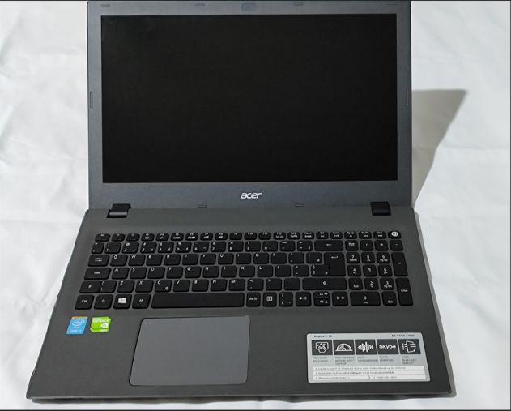

# 💻 Laboratório de Manutenção & Documentação de Incidentes | Acer Aspire E15

## 📌 Visão Geral do Repositório
Este repositório funciona como uma **Base de Conhecimento Técnica (Knowledge Base)** centrada na análise, diagnóstico e manutenção do notebook **Acer Aspire E 15 (E5-573G)**. 

O objetivo principal é documentar a resolução de falhas de hardware, manutenção preventiva e upgrades de componentes utilizando uma metodologia estruturada de **isolamento de causas raízes**, servindo tanto como documentação de portfólio profissional quanto como guia de consulta pública.

---

## 🛠️ Especificações Técnicas do Equipamento

🔍 Clique para expandir as especificações de hardware da bancada

| Componente | Especificação |
| :--- | :--- |
| **Modelo** | Acer Aspire E15 (E5-573G-74Q5) |
| **Processador** | Intel Core i7-5500U (5ª Geração) |
| **Memória RAM** | 8GB DDR3L 1600MHz |
| **Armazenamento Padrão** | HD 1TB SATA III |
| **Gráficos Integrados / Dedicados** | Intel HD Graphics 5500 / NVIDIA GeForce 920M 2GB |
| **Sistema Operacional** | Windows 10 64 bits |

---

## 📂 Índice de Incidentes & Chamados Documentados

Abaixo está o registro de intervenções técnicas organizadas por subpastas. Cada incidente contém um relatório técnico detalhado em página única.

| ID | Incidente / Atendimento | Categoria | Status | Link da Documentação |
| :---: | :--- | :--- | :---: | :---: |
| **#01** | Falha de Inicialização, troca de bateria | Hardware e Software | 🟢 Concluído | [Acessar Relatório #01](./troubleshooting-01/README.md) |

---

## 🔗 Mídias e Contato Profissional

- 📺 **Playlist de Portfólio (YouTube)** https://www.youtube.com/playlist?list=PLDxAX6iHRsUk

- 📁 **Repositório de Projetos:** [Voltar para a lista de projetos do GitHub](https://github.com/brenobergman?tab=repositories)

---