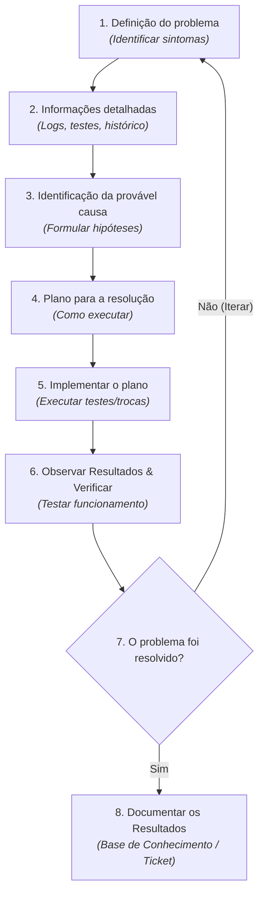

# 🛠️ Incidente #01: Falha de Inicialização e problema de bateria

> [!IMPORTANT]
> Escrita em andamento! Podem estar faltando partes ou a estrutura não estar adequada.

## **Vídeo do procedimento**

> [!NOTE]
> 
>* Procedimento resumido + dicas de uso/manutenção.
>* No vídeo o processo de resolução foi realizado apenas pela troca da bateria, o que é apenas uma parte da solução definitiva mas o incômodo é resolvido. 

---

> [!IMPORTANT]
> Essa documentação, **em específico**, está documentada a fim de mostrar o processo de resolução recomendado no curso da Cisco Networking Academy: "It Costumer Support Basics".

---

## 📍 Sumário

* ### [Passos da resolução](#passos)
  * #### [1. Definição do problema](#1-definicao-problema)
  * #### [2. Informações detalhadas](#2-informacoes-detalhadas)
  * #### [3. Identificação da provável causa](#identificacao-da-provavel-causa)
  * #### [4. Plano para a resolução](#plano-para-a-solucao)
  * #### [5. Implementar o plano](#implementar-plano)
  * #### [6. Observar Resultados & Verificar](#observar-resultados-verificar)
  * #### [7. O problema foi resolvido?](#problema-resolvido)
* ### [Referências](#referencias)

---

- ## **Passos da Resolução**

> 📌 **Nota de Metodologia:** O diagrama acima é uma representação autoral baseada na metodologia apresentada no curso da Cisco Networking Academy.

## 1. Definição do problema 

<figure>
  
  <figcaption>Figura 1 — O erro ao inicializar.</figcaption>
</figure>

O problema principal que incomoda o usuário é a inicialização, que é nececssário intervir a cada vez que vai ligar. Em segundo plano a questão da bateria não reter carga, que já vinha a um tempo assim.

### Problema:

**Notebook não inicializa normalmente e não carrega a bateria.** 

### Sintomas:  

- Não liga sem estar conectado na tomada;

- Mesmo carregando por horas a bateria não muda de 0%;  

- Depois de até três tentativas ele inicializa, aparece a logo da Acer, mas logo aparece "No Bootable Device";

- Para inicializar o SO é alterado o modo de inicialização de UEFI (padrão da BIOS) para Legacy.

> [!NOTE]
> | MBR — Master Boot Record | GPT — GUID Partition Table |
> | :--- | :--- |
> | Tradicionalmente utilizado com BIOS Legacy. | Projetado para funcionar com UEFI. |
> | Suporta até 4 partições primárias, sem considerar partições estendidas. | Suporta muitas partições, conforme o sistema operacional e a implementação. |
> | Tem limite aproximado de 2 TB para discos com setores lógicos de 512 bytes. | Permite utilizar discos maiores que 2 TB. |
> | Armazena informações de inicialização no início do disco. | Mantém cópias redundantes das estruturas de particionamento e mecanismos de verificação de integridade. |

## 2. Informações detalhadas 

Foi apurado se algo foi feito no dispositivo antes de começarem estes erros na inicialização, com fim de encontrar a causa, e descobriu-se que começou a aproximadamente três anos junto com desligamentos inesperados, pela porcentagem mostrada da bateria estar errada e que nos útimos tempos apareceram mais vezes o erro e, depois de fazer calibragens da bateria para correção da porcentagem, ela não carrega mais e o dispositivo não liga sem estar na tomada.

Por estar relacionado à bateria, testou-se deixar conectado à tomada depois de feita a operação para contornar (troca de UEFI para Legacy) e ele consegue iniciar o SO normalmente, ou até se em pouco tempo desconectado. Mas se ficar muito tempo desconectado, retorna na mesma mensagem de “No Bootable Device”.

Nos testes, acabou chegando no WinRE (Windows Recovery Environment - ambiente de recuperação oficial da Microsof), que inicia após três erros de inicialização. Foi tentado o reparo por software da inicialização e não resolveu.

Ademais enquanto carrega, a luz indicadora de carregamento pisca a cada vinte segundos.

## 3. Identificação da provável causa 

A partir do que foi exposto do caso 

Como a bateria estava relacionada, os testes são direcionados a ela. Geralmente se começa da 

#### **🔍 Matriz de Testes**

| Componente Analisado | Hipótese do Problema | Teste/Procedimento Executado | Resultado do Teste | Status |
| :--- | :--- | :--- | :--- | :---: |
| **Memória RAM** | Mau contato / Falha de módulo | Limpeza dos contatos e teste individual dos pentes em bancada | Memórias validadas e funcionais | 🟢 OK |
| **Tela / Display** | Defeito no painel LCD | Conexão de vídeo externo via porta HDMI | Vídeo gerado no monitor externo | 🟢 OK |
| **Cabo Flat (eDP)** | Rompimento ou conector solto | Inspeção de continuidade e verificação de encaixe lógico | Trava solta e oxidação leve | 🔴 Falha |

Portanto, a causa provável foi definidad como: 

>### **Bateria principal do notebook no fim da vida útil alterando para o modo padrão de inicialização diferente do que o sistema operacional foi instalado.**

## 4. Plano para a resolução 

## 5. Implementar o plano 

### 🛡️ 1. Segurança e Preparação da Bancada

> [!WARNING]
> ### ⚠️ **Protocolo de Segurança Eletrostática (ESD):** 
> Antes de qualquer intervenção interna na placa-mãe, o equipamento foi desenergizado via desconexão da **bateria principal** e remoção da **pilha CMOS** para zerar cargas residuais dos capacitores.

* **Insumos Utilizados:** Álcool Isopropílico 99.8%, Pasta Térmica à base de Prata, Pincel Antiestático e Manta ESD.
* **Ferramental:** Jogo de chaves de precisão PH0/PH00 e espátulas plásticas de náilon.

> **💡 Dica de bancada:** Mantenha os parafusos organizados em um organizzador magnético para evitar perdas.

## 6. Observar Resultados & Verificar

## 7. O problema foi resolvido?

> [!NOTE]
>***Passo 8 é a própria documentação**

---

## 📚 Referências & links úteis

- Resposta da Acer sobre “No Bootable Device” na inicialização.: https://community.acer.com/pt/kb/articles/94-mensagem-de-erro-nenhum-dispositivo-de-arranque  

- Artigo na comunidade da Acer sobre BIOS e UEFI e seus formatos de arquivo: https://community.acer.com/en/discussion/271870/uefi-bios-mbr-gpt-disks-and-multi-boot 

- Comparação entre UEFI e Legacy (BIOS) da comunidade da Microsoft: https://learn.microsoft.com/pt-br/answers/questions/4199903/uefi-ou-legacy-windows-10 

- Resposta da Acer sobre como resetar a bateria do notebook: https://community.acer.com/pt/kb/articles/75-reset-da-bateria-interna 

- Resposta da Acer sobre a troca da bateria CMOS: https://community.acer.com/pt/kb/articles/14725-substituicao-da-bateria-cmos 

- Um problema que pode ocorrer no circuito da bateria CMOS:   https://www.youtube.com/watch?v=WaeN5INrzFE 

- Problema parecido de não estar guardando as configurações da BIOS: https://www.youtube.com/watch?v=xP1v34YLTew&t=2680s 

- Vídeo sobre como verificar o cabo de alimentação e a bateria CMOS com multímetro: https://www.youtube.com/watch?v=ZKvkLKaF8tk 

- Vídeo sobre como gerar o relatório da bateria pelo prompt de comando: https://www.youtube.com/watch?v=zY4uOIsIQzw 

- Nota da Asus sobre descarga eletrostática na manutenção de dispositivos: https://www.asus.com/br/support/faq/1045590/ 

- Referência para desmontagem do notebook: https://www.youtube.com/watch?v=iur6mcvka_4 

- Processo de calibragem da nova bateria, pela BringIT: https://suporte.bringit.com.br/hc/pt-br/articles/200970947-Como-calibrar-a-bateria-do-meu-notebook 

- Artigo sobre conserto de baterias de notebook e sobre medição delas: https://www.batteryuniversity.com/article/bu-911-how-to-repair-a-laptop-battery 

- Como converter de legacy para UEFI: https://www.youtube.com/watch?v=qagvw8iRPJ4 

- mAh ou Wh para compra de bateria: https://batteryswapstation.com/pt/mah-vs-wh/

---

### [⬆️ Voltar ao Topo](#topo)

### [⬅️ Voltar ao Índice Geral do Repositório](../README.md)