
# 🛠️ Processo de resolução de problema em 8 passos

  <b><big><a href="../README.md">⬅️ Voltar ao Índice Geral do Repositório</a></big></b> &nbsp;|&nbsp; <b><big><a href="knowledge-base.md">➡️ Base de Conhecimento Técnica</a></big></b>

 
> [!IMPORTANT]
>🚧  Escrita em andamento! Podem estar faltando partes ou a estrutura não estar adequada. 🚧 

> [!NOTE]
> **Vídeo do procedimento**.
>
>  
> * Procedimento resumido + dicas de uso/manutenção.

---

> [!IMPORTANT]
> Essa documentação, foi incluída a este incidente, **em específico**, para mostrar o processo de resolução recomendado no curso da Cisco Networking Academy: "IT Costumer Support Basics", que foi aplicado neste incidente e está resumido no vídeo.

Visualmente, o processo de resolução pode ser compreendido por meio do diagrama abaixo. O conceito mais importante do processo que fica visível com essa visualização é o passo 7, onde ocorre a **iteração** do processo enquanto este não é resolvido. Assim, justamente por isso, o processo de resolução é compreendido como um **ciclo**. 

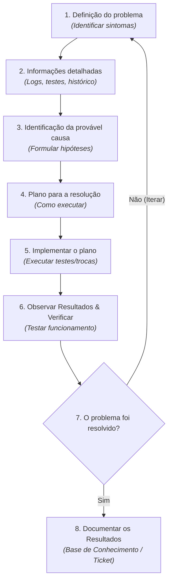

> 📌 **Nota de Metodologia:** O diagrama acima é uma representação autoral baseada na metodologia apresentada no curso da Cisco Networking Academy.

---

## 📍 Sumário

* ### [Passos da resolução](#passos)
  * #### [1. Definição do problema](#1-definicao-problema)
  * #### [2. Informações detalhadas](#2-informacoes-detalhadas)
  * #### [3. Identificação da provável causa](#identificacao-da-provavel-causa)
  * #### [4. Plano para a resolução](#plano-para-a-solucao)
  * #### [5. Implementar o plano](#implementar-plano)
  * #### [6. Observar Resultados & Verificar](#observar-resultados-verificar)
  * #### [7. O problema foi resolvido?](#problema-resolvido)
* ### [Referências](#referencias)

---

## 1. Definição do problema 

Na etapa inicial o problema deve ser definido claramente por seus sintomas e onde de fato ocorre. Isso a fim de definir o **escopo** e se concentrar em onde realmente uma alteração fará efeito, para uma resolução rápida.

O problema principal que incomodava o usuário é a inicialização, que ele tinha que intervir na maioria das vezes para iniciar. Ele ligava o notebook, a tela ligava junto com o cooler e a luz de energia, e então desligava tudo; isso duas ou três vezes. Então, na próxima vez que isso ocorria aparece o logo da Acer (Post) e logo após o aviso `NO BOOTABLE DEVICE`. O que o usuário fazia para contornar isso é alterar o modo de inicialização de UEFI (padrão do firmware) para Legacy, na BIOS, na maior parte das inicializações. 

   
  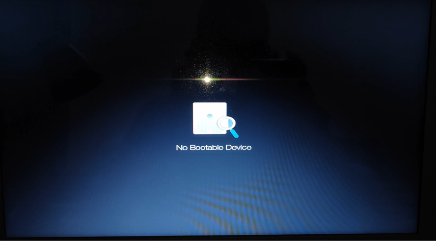
   
  <i>Imagem 1 — Erro "No Bootable Device" ao inicializar.</i>
     
  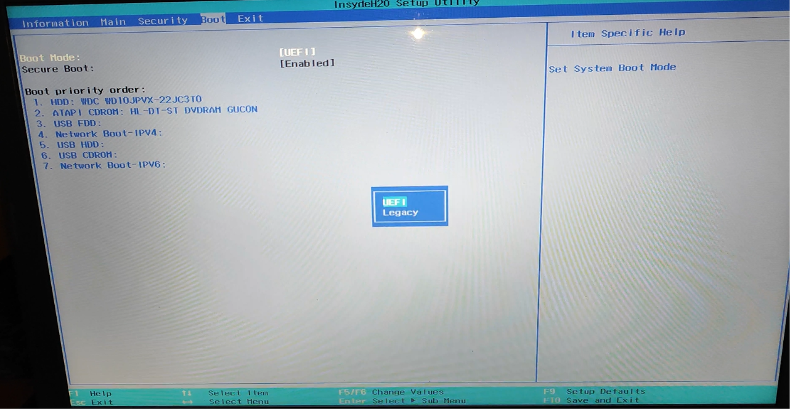
   
  <i>Imagem 2 — Alterando o modo de inicialização na BIOS, de UEFI para Legacy.</i>
  
&nbsp;

Mas ocorria também a questão da bateria não reter carga, que já vinha um tempo assim; a bateria era original e de 2015, então o usuário já sabia que precisaria trocar, no entanto, como o notebook ainda estava funcionando mesmo com a bateria ruim (como um desktop) ele a deixou assim, mas o que realmente incomodava era a questão de ter que intervir a cada inicialização.

   
  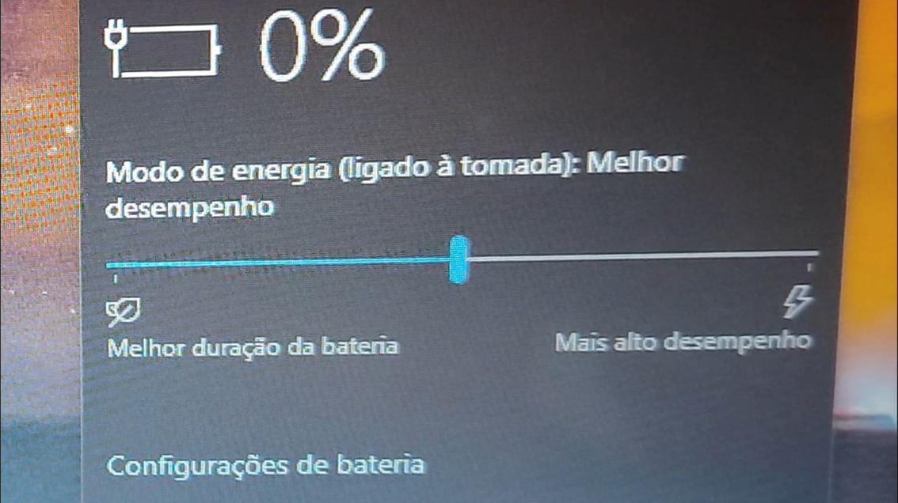
   
  <i>Imagem 3 — A porcentagem informada pelo sistema operacional permanece em 0%.</i>
  
&nbsp;

Portanto, eram dois problemas, um de inicialização e outro de bateria, que poderia estar relacionado. Por isso é importante adquirir mais detalhes com o passo 2.

### Problema:

**Notebook não inicializa normalmente e não carrega a bateria.** 

### Sintomas:  

- Não liga sem estar conectado na tomada.
- Mesmo carregando por horas a bateria não muda de 0%.
- Depois de até três tentativas ele inicializa, aparece a logo da Acer, mas logo aparece `No Bootable Device`.
- Para inicializar é alterado o modo de inicialização de UEFI (padrão da BIOS) para Legacy.

> [!NOTE]
>
> ## Por que não inicializa no modo de inicialização UEFI, padrão do firmware nesse caso?
>
> Cada modo utiliza um mecanismo diferente para localizar e executar os arquivos de inicialização nos dispositivos conectados, como HDDs, SSDs e pendrives. No caso, o sistema operacional havia sido instalado em um disco com particionamento MBR, utilizando o modo Legacy. Nesse modo, a inicialização ocorre por meio do código de boot localizado no MBR do disco.
>
>Já no modo UEFI, o firmware procura um carregador de inicialização no formato EFI (`.efi`), normalmente armazenado em uma partição específica chamada EFI System Partition (ESP), geralmente formatada em FAT32. Em instalações convencionais do Windows, essa configuração exige que o disco do sistema utilize o particionamento GPT.
>
>Portanto, como o sistema havia sido instalado em MBR no modo Legacy, ele não possuía a estrutura de inicialização UEFI necessária para iniciar diretamente nesse modo. Para inicializá-lo, seria necessário utilizar o modo Legacy (ou CSM, caso disponível) ou converter o disco para GPT e configurar os arquivos de inicialização UEFI.
>
> Tabela comparativa entre os formatos de particionamento MBR e GPT:
>
> | MBR — Master Boot Record | GPT — GUID Partition Table |
> | :--- | :--- |
> | Tradicionalmente utilizado com BIOS Legacy. | Projetado para funcionar com UEFI. |
> | Suporta até 4 partições primárias, sem considerar partições estendidas. | Suporta muitas partições, conforme o sistema operacional e a implementação. |
> | Tem limite aproximado de 2 TB para discos com setores lógicos de 512 bytes. | Permite utilizar discos maiores que 2 TB. |
> | Armazena informações de inicialização no início do disco. | Mantém cópias redundantes das estruturas de particionamento e mecanismos de verificação de integridade. |

## 2. Informações detalhadas

Nesta etapa, mais informações são buscadas com base no problema definido. Ou seja, enquanto na etapa anterior era buscado O QUE ERA, agora se busca: "Desde quando isso ocorre", "algo que foi alterado antes do funcionamento normal", etc. Com estas informações o que se tinha do problema deixa apenas de ser uma definição dele para uma descrição mais completa dele, de seu "entorno" e de seu histórico. Essas informações a mais, unidas, ajudam a obter **pistas** sobre a provável causa.

Foi apurado se algo foi feito no dispositivo antes de começarem esses erros na inicialização, porque isso pode ser decorrente de alguma má configuração que o usuário fez ou por outros erros. E descobriu-se que começou a aproximadamente três anos em paralelo com desligamentos inesperados, pela porcentagem mostrada da bateria estar errada. Ademais, nos últimos tempos apareceram mais vezes o erro e, posteriormente a uma calibragem da bateria para correção da porcentagem, ela já não carregava mais e o dispositivo não ligava sem estar na tomada.

Um teste rápido realizado para coletar mais informações desse problema, pela informação anterior indicar que apareceu junto com a degradação da bateria, foi o de realizar a configuração da BIOS e então verificar se eram mantidas deixando conectado na tomado depois de desligar. O resultado foi que de fato as configurações foram preservadas, mas deixando desconectado, por um tempo, já são perdidas. Isso garantiu duas coisas: a energia flui do plugue que vem da fonte até o circuito responsável por manter as alterações na BIOS, assim como até o componente que preserva elas, e que a bateria desempenhava antes um papel no salvamento das alterações.

   
  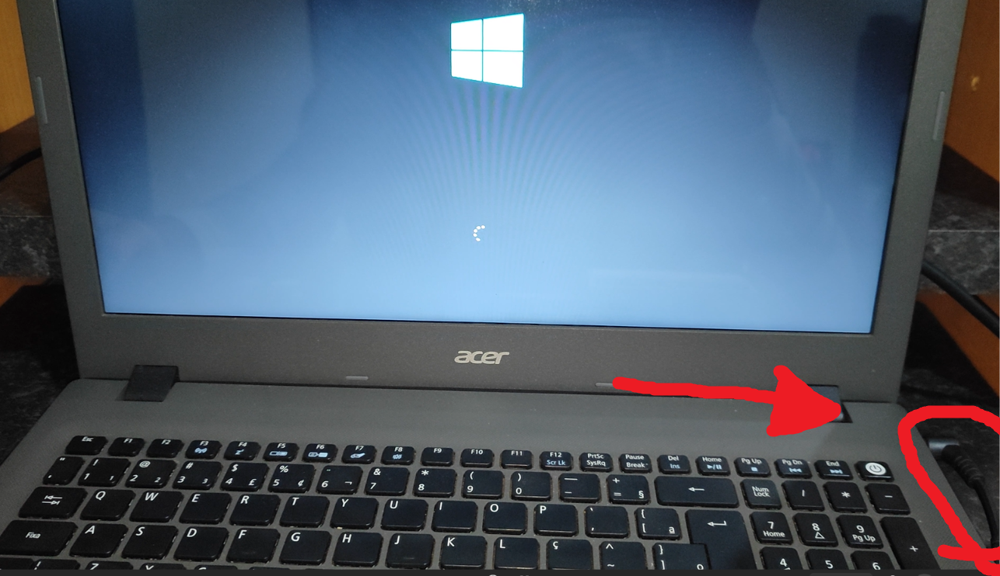
   
  <i>Imagem 4 — Inicialização normal pela preservação das configurações pela energia da tomada.</i>
  
&nbsp;

Então, principalmente pela inicialização apresentar mais vezes o erro em sequência de um procedimento que acarretou também com perda da capacidade da bateria de armazenar a carga, esse processo de encontrar detalhes levou a uma pista importante, a bateria como uma possível causa.

### Detalhes:

- Porcentagem da bateria estava indicando errada.
- Após calibração da bateria e ela não reteve mais carga, notebook ficou dependente de estar na tomada.
- Problema da inicialização predominou depois da calibragem da bateria.
- Se conectado à energia, despois de desligado, permanecem as configurações na próxima inicialização.

## 3. Identificação da provável causa 

Aqui é feita uma lista das causas possíveis, da mais simples e fácil a mais complexa e difícil de lidar. E uma delas é selecionada para seguir com o próximo passo, começando pelo início da lista. As causas menos prováveis devem ser descartadas justamente pelo que é apurado das informações se obteve até agora, isso já é o filtro do **isolamento de causas**.

Há a opção, para se ter mais certeza ou facilidade na resolução, de fazer pesquisa sobre o problema com as informações que se tem. Várias formas podem ser utilizadas como fonte, entre elas: IA (consciente de que ela pode errar), fóruns online, base de conhecimento, artigos de sites.

Neste problema, foi tentado obter ajuda dos artigos do suporte oficial da Acer, porque pode ter algo em específico que a empresa que produz o notebook pode trazer de informação, como ela é a detentora de todas as informações sobre ele. No entanto, consultando pelo SN (Serial Number), foi descoberto que já não constam informações sobre, porque é um dispositivo antigo e é comum das empresas descontinuarem a disposição das informações. Mas pela palavra-chave "No Bootable Device" na pesquisa geral pelos artigos foi encontrado um conteúdo, dentre muitos, relacionado com o problema que apenas falava sobre a alteração na BIOS do modo de inicialização. 

   
  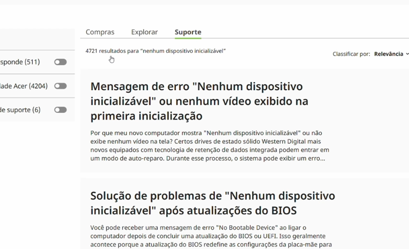
   
  <i>Imagem 5 — Suporte da acer (https://www.acer.com/br-pt/search/search-support?search=nenhum%20dispositivo%20inicializ%C3%A1vel) após aplicar a pesquisa por palavra-chave.</i>
  
&nbsp;

Partiu-se para uma busca geral pelo navegador por `"E5-573G-74Q5" "no bootable device"`, porque utilizando o mecanismo de busca Google isso filtra a busca por exatamente estas palavras no conteúdo web, pelo uso dos operadores aspas. Unindo esses dois o conteúdo focará no modelo exato do notebook e na mensagem exata do erro. Mesmo valendo-se dessa técnica de pesquisa avançada os conteúdos que pareceram eram genéricos, sem especificidade com o problema enfrentado.

   
  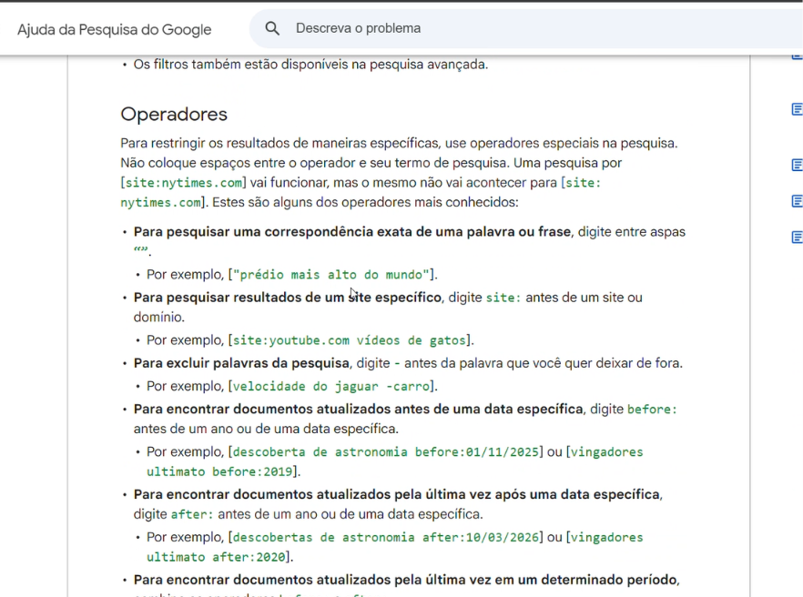
   
  <i>Imagem 6 — Intruções para pesquisa avançada com operadores fornecida do mecanismo de pesquisa Google (https://support.google.com/websearch/answer/2466433).</i>
  
&nbsp;

Por fim, para fim de confirmar de forma mais rápida se de fato a bateria poderia estar relacionada e seguir em frente com o processo, como última alternativa às pesquisas malsucedidas, foi feito um prompt simples para a inteligência artificial Gemini, do Google, com a visão geral do problema. Porque com os dados que se tinha até então e por ter maior certeza de serem as baterias, a resposta da IA poderia ser mais um indicativo, caso confirmasse, ou traria outra observação que não foi percebida até então. isso considerando um retorno com menos erro possível, mas caso fosse algo muito discrepante seria rapidamente percebido pelo que foi estudado do problema. Em outras palavras, independente do retorno que o modelo fornecesse, seria uma tentativa a mais de pesquisa. O prompt utilizado e as partes principais de seu retorno estão apresentados nas imagens abaixo.

  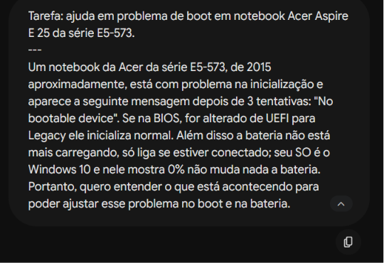
   
  <i>Imagem 7 — Prompt feito para a inteligência artificial Gemini.</i>
     
  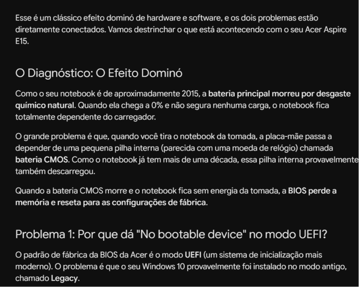
   
  <i>Imagem 8 — Parte 1 da resposta da IA.</i>
     
  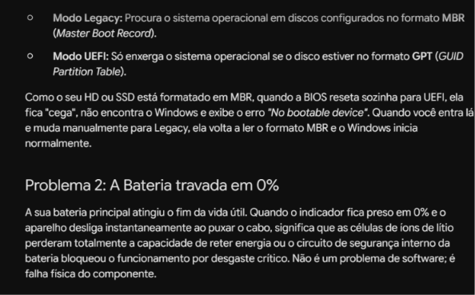
   
  <i>Imagem 9 — Parte 2 da resposta da IA.</i>
  
&nbsp;

Diante do que foi obtido e o fato de a bateria ter relação no problema, ela aparece em todas as hipóteses. Além disso, visto que é necessária intervenção do usuário na BIOS muitas vezes, a bateria CMOS que desempenha um papel de garantir que tais configurações não sejam perdidas pode também ter sido desgastada junto, como apontado pela IA. Já que possivelmente o circuito ficou só dependente dela com a falta da contribuição da principal. Ou seja, ela acabou forçando com o tempo e degradou.

Contudo, pode ser outra a causa, por isso o caminho até a energia chegar e carregar a bateria pode ser uma causa, porque se ele estiver com falha, logicamente a bateria não irá ser carregada. Apesar da bateria ser antiga e provavelmente estar no fim da vida útil. No entanto, em ambas as hipóteses a CMOS entra na lista por ser algo comum de perder a capacidade com o tempo.

A hipótese da lista abaixo que foi selecionada para andamento do processo foi a que está em destaque.

> [!TIP]
> Problemas no circuito que preserva as configurações não foram listados por conta de na etapa 2 ser considerado que ele está passando energia. Isso foi importante para eliminar uma possibilidade.

### Lista de provável causa:

1. **Bateria principal e bateria CMOS do notebook no fim da vida útil**
2. Carregador do notebook não carregando a bateria principal e bateria CMOS no fim da vida útil.

## 4. Plano para a resolução 

Agora, com o escopo do que tem que ser resolvido, com as pistas do que pode ser, é o momento de ter um roteiro de como trabalhar na resolução para que esta tenha êxito. Logo, um plano para como resolver é traçado a partir de uma hipótese do passo 3. Observe abaixo que ele pode ter alternativas dentro dele mesmo caso algo dê errado na própria hipótese selecionada, de acordo com o que for sendo obtido na resolução.

Para este problema e para muitos, é bom começar com o menos invasivo, para não correr o risco com alternativas que exigem desmontagem do equipamento. Isso é notado no plano quando se vem realizando testes e diagnósticos antes de realizar qualquer abertura do equipamento.

Do 1 ao 3 são feitas ações para garantir que é a bateria. Ao completar o passo 3 haverá informações suficientes para poder continuar com o descrito no passo 5 ou para desviar para outra causa, conforme o passo 6. Portanto, esse plano considera que ainda podem surgir informações no processo que influenciarão na decisão de qual é a causa raiz.

### Plano caso seja a bateria principal e a bateria CMOS

1. Realizar reset da bateria e testar se carrega.
2. Checar saúde da bateria pelo diagnóstico de gerenciamento de energia do Windows, estando atento a capacidade informada e aos avisos. 
3. Checar carregador.
4. Se o carregador estiver ruim:
    - 4.1. Tentar carregar com outro.
5. Caso tudo continue indicando as baterias:
    - 5.1. Retirar a bateria principal.
    - 5.2. Verificar suas especificações.
    - 5.3. Substituir por uma nova e compatível.
    - 5.4. Checar voltagem da bateria CMOS
    - 5.5. Se tensão abaixo do nominal: 
        - 5.5.1. Substituir a célula CMOS.
    - 5.6. Se a bateria CMOS apresentar voltagem normal:
        - 5.6.1. Testar se configurações são preservadas com outra nova.
6. Caso não esteja indicando as baterias, mas o carregador ou outro componente:
    - 6.1. Voltar para o processo de identificação de causa provável.
    - 6.2. Caso não tenha uma causa listada que esteja próxima dos indicativos:
        - 6.2.1. Registrar novos sintomas/medições, pesquisar códigos ou comportamentos observados e abrir uma nova hipótese de falha.
    - 6.3. Seguir com outro plano a partir de uma causa provável listada.

## 5. Implementar o plano 

Este é o passo onde ocorrem as intervenções apresentados no plano. Cada etapa é realizada por vez para garantir que de fato um passo resolve ou a sequência de passos está apresentando resultados.

Seguindo o plano, realizou-se o reset da bateria. Para tal procedimento, um objeto recomendado a ser introduzido é um clipe de papel (de preferência com o arame com uma ponta reta). O equipamento deve estar desconectado do adaptador de 
energia e toatalmente desligado. O clipe deve ser inserido até alcançar o componente (que nesse caso não é um botão que dá para sentir "clique" ao pressionar) e pressionado (sem forçar) por 5 segundos. Depois, esperar mais alguns segundos, para dissipar energia, e então conectar a fonte ao notebook e ligá-lo.

>[!WARNING]
> Pressionar apenas um pouco. Pois o componente é tátil não um botão e apesar de não sentir o "clique", ele funciona sem pressão excessiva. Forçá-lo pode deformá-lo.

   
  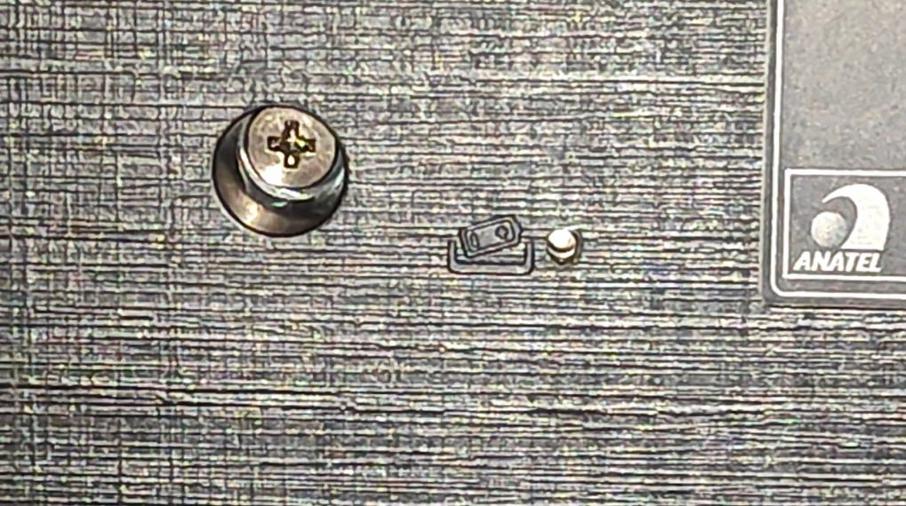
   
  <i>Imagem 10 — Reset hole (orifício de reset) do Acer E5-573G-74Q5.</i>
  
&nbsp;

<!-- TODO: continuar aqui - descrevendo o processo de checagem por software -->

O processo de reset não teve efeito nenhum sobre o dispositivo. Logo, fora seguido com o próximo item do plano, a checagem por software do estado da bateria e seus registros.

   
  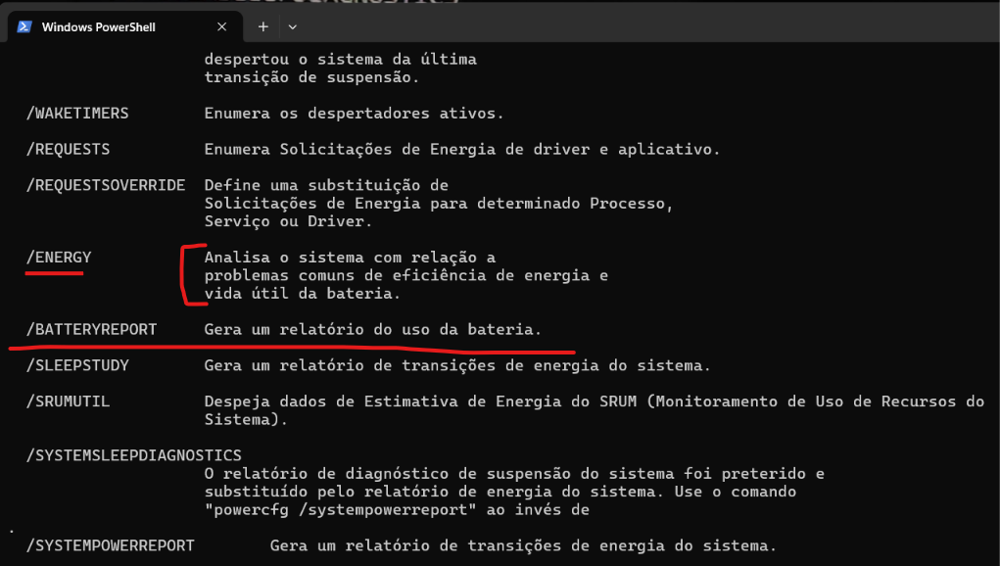
   
  <i>Imagem 11  — .</i>
     
  
   
  <i>Imagem  — texto</i>
  
&nbsp;

### 🛡️ 1. Segurança e Preparação da Bancada

> [!WARNING]
> ### ⚠️ **Protocolo de Segurança Eletrostática (ESD):** 
> Antes de qualquer intervenção interna na placa-mãe, o equipamento foi desenergizado via desconexão da **bateria principal** e remoção da **pilha CMOS** para zerar cargas residuais dos capacitores.

* **Insumos Utilizados:** Álcool Isopropílico 99.8%, Pasta Térmica à base de Prata, Pincel Antiestático e Manta ESD.
* **Ferramental:** Jogo de chaves de precisão PH0/PH00 e espátulas plásticas de náilon.

> **💡 Dica de bancada:** Mantenha os parafusos organizados em um organizzador magnético para evitar perdas.

A matriz de testes abaixo fornece de forma mais rápida e resumida os resultados dos testes. Isso é importante para saber se segue ou não com passos do plano que dependem dos resultados. Ou seja, ela ajuda a tomar uma decisão racional conforme a especificidade de cada resultado possível.

### **🔍 Matriz de Testes**

| Componente Analisado | Hipótese do Problema | Teste/Procedimento Executado | Resultado do Teste | Status |
| :--- | :--- | :--- | :--- | :---: |
| **Carregador** | Mau contato / Falha de módulo | Limpeza dos contatos e teste individual dos pentes em bancada | Memórias validadas e funcionais | 🟢 OK |
| **Tela / Display** | Defeito no painel LCD | Conexão de vídeo externo via porta HDMI | Vídeo gerado no monitor externo | 🟢 OK |
| **Cabo Flat (eDP)** | Rompimento ou conector solto | Inspeção de continuidade e verificação de encaixe lógico | Trava solta e oxidação leve | 🔴 Falha |

## 6. Observar Resultados & Verificar

## 7. O problema foi resolvido?

> [!NOTE]
>***Passo 8 é a própria documentação**

---

## 📚 Referências & links úteis

- Resposta da Acer sobre “No Bootable Device” na inicialização.: https://community.acer.com/pt/kb/articles/94-mensagem-de-erro-nenhum-dispositivo-de-arranque

- Instruções do Google para pesquisa avançada: https://support.google.com/websearch/answer/2466433

- Artigo na comunidade da Acer sobre BIOS e UEFI e seus formatos de arquivo: https://community.acer.com/en/discussion/271870/uefi-bios-mbr-gpt-disks-and-multi-boot 

- Comparação entre UEFI e Legacy (BIOS) da comunidade da Microsoft: https://learn.microsoft.com/pt-br/answers/questions/4199903/uefi-ou-legacy-windows-10 

- Resposta da Acer sobre como resetar a bateria do notebook: https://community.acer.com/pt/kb/articles/75-reset-da-bateria-interna 

- Resposta da Acer sobre a troca da bateria CMOS: https://community.acer.com/pt/kb/articles/14725-substituicao-da-bateria-cmos 

- Um problema que pode ocorrer no circuito da bateria CMOS:   https://www.youtube.com/watch?v=WaeN5INrzFE 

- Problema parecido de não estar guardando as configurações da BIOS: https://www.youtube.com/watch?v=xP1v34YLTew&t=2680s 

- Vídeo sobre como verificar o cabo de alimentação e a bateria CMOS com multímetro: https://www.youtube.com/watch?v=ZKvkLKaF8tk 

- Vídeo sobre como gerar o relatório da bateria pelo prompt de comando: https://www.youtube.com/watch?v=zY4uOIsIQzw 

- Nota da Asus sobre descarga eletrostática na manutenção de dispositivos: https://www.asus.com/br/support/faq/1045590/ 

- Referência para desmontagem do notebook: https://www.youtube.com/watch?v=iur6mcvka_4 

- Processo de calibragem da nova bateria, pela BringIT: https://suporte.bringit.com.br/hc/pt-br/articles/200970947-Como-calibrar-a-bateria-do-meu-notebook 

- Artigo sobre conserto de baterias de notebook e sobre medição delas: https://www.batteryuniversity.com/article/bu-911-how-to-repair-a-laptop-battery 

- Como converter de legacy para UEFI: https://www.youtube.com/watch?v=qagvw8iRPJ4 

- mAh ou Wh para compra de bateria: https://batteryswapstation.com/pt/mah-vs-wh/

---

  <b><big><a href="#topo">⬆️ Voltar ao Topo</a></big></b> &nbsp;|&nbsp;
  <b><big><a href="../README.md">⬅️ Voltar ao Índice Geral do Repositório</a></big></b> &nbsp;|&nbsp;
  <b><big><a href="knowledge-base.md">➡️ Base de Conhecimento Técnica</a></big></b>

